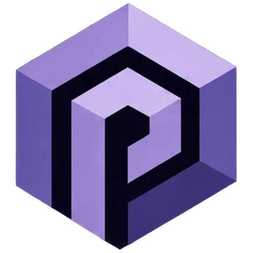
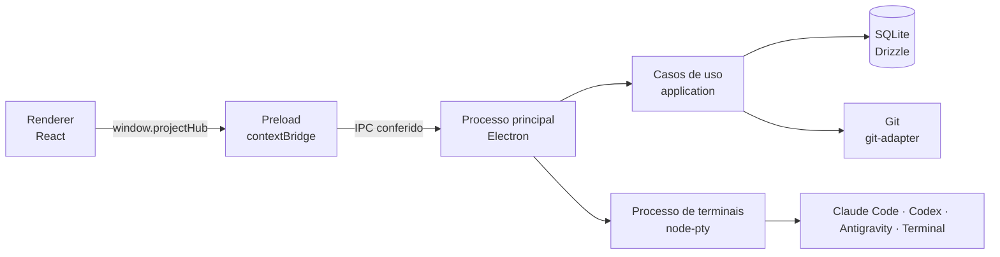

<div align="center">



# Project Hub

**Um hub local para organizar projetos, missões e agentes de IA num só lugar.**

[](https://github.com/charles777renan-byte/Project-Hub-IDE/actions/workflows/ci.yml)


[Começando](#começando) · [Funcionalidades](#funcionalidades) · [Arquitetura](#arquitetura) · [Comandos](#comandos) · [Contribuindo](#contribuindo)

</div>

## Sobre

O Project Hub é um aplicativo desktop, feito com Electron, para acompanhar projetos e coordenar agentes de IA. Você cadastra as pastas dos seus projetos, vê o estado do Git de cada uma e cria **missões**. Cada missão roda isolada num worktree próprio, e o trabalho só é concluído depois da sua revisão.

O projeto está em desenvolvimento ativo, então a interface e os fluxos mudam com frequência.

**Plataforma:** o alvo de lançamento é o Windows, onde o app é desenvolvido e testado hoje. macOS e Linux estão no planejamento.

## Funcionalidades

### Projetos

- Cadastro de pastas como projetos, com grupos, apelidos e arquivamento.
- Estado do Git de cada projeto, com o status e o diff das alterações.

### Missões

- Um worktree por missão, criado e removido pelo app, sem apagar trabalho que ainda não foi salvo.
- Planejamento em tarefas, com aprovação de ações sensíveis por políticas ([ADR 0006](docs/adr/0006-aprovacao-por-politicas.md)).
- Revisão humana antes da conclusão: quando o agente termina, a missão vai para revisão, e você aprova ou pede ajustes.

### Agentes e terminais

- Terminais para Claude Code, Codex, Antigravity CLI e o terminal do sistema, em painéis divididos lado a lado.
- Os terminais rodam num processo separado do app. Eles continuam vivos quando a janela fecha e são reaproveitados quando o app abre de novo.

### Início

- Visão geral do uso de cada agente, em mensagens e em tokens, com filtro por período.
- Limites de uso da assinatura do Claude, lidos com o `claude` instalado na máquina.

### Interface

- Barra lateral com os grupos de projetos e a atividade dos agentes, além de uma barra de status.
- Paleta de comandos para navegar e agir pelo teclado.

### Segurança

- O renderer não tem acesso ao Node.js. Ele roda com isolamento de contexto, sandbox e Content Security Policy.
- A navegação fica presa à origem do app, e as permissões do navegador são negadas.
- Links externos só abrem depois de confirmação.
- Cada chamada IPC é conferida pelo remetente, e cada resposta, pelo schema do canal ([ADR 0001](docs/adr/0001-electron-renderer-isolado.md)).

## Começando

### Requisitos

| Ferramenta  | Versão           | Observação                                                                      |
| ----------- | ---------------- | ------------------------------------------------------------------------------- |
| Node.js     | 24.22.0 (LTS)    | Fixada em `.nvmrc`                                                              |
| pnpm        | 12.14.0          | Fixado no campo `packageManager` do `package.json`                              |
| Git         | recente, no PATH | Usado pelos projetos e pelos worktrees                                          |
| Claude Code | opcional         | Necessário para missões e planejamento reais, ver [Configuração](#configuração) |

Com o Corepack, `corepack enable` basta. Sem ele, use `npm install -g pnpm@12.14.0`.

### Instalação

```bash
git clone https://github.com/charles777renan-byte/Project-Hub-IDE.git
cd Project-Hub-IDE
pnpm install
pnpm dev
```

Na primeira execução, `pnpm dev` baixa o binário do Electron.

### Configuração

O app lê as variáveis do ambiente do processo na inicialização. Ele não carrega um arquivo `.env`.

| Variável                   | Efeito                                                                                                                            |
| -------------------------- | --------------------------------------------------------------------------------------------------------------------------------- |
| `APP_AGENT_ADAPTER`        | Com `claude-code`, as missões e o planejamento usam o Claude Code de verdade. Sem ela, as missões usam um agente de demonstração. |
| `APP_WORKTREES_ROOT`       | Pasta onde ficam os worktrees das missões. Padrão: `ProjectHub/worktrees` na pasta do usuário.                                    |
| `APP_MAX_RUNNING_MISSIONS` | Quantas missões podem rodar ao mesmo tempo.                                                                                       |

Para usar o Claude Code, o comando `claude` precisa estar no PATH e com o login feito. Exemplo no PowerShell:

```powershell
$env:APP_AGENT_ADAPTER = "claude-code"
pnpm dev
```

## Comandos

| Comando                 | O que faz                                                     |
| ----------------------- | ------------------------------------------------------------- |
| `pnpm dev`              | Abre o aplicativo em desenvolvimento                          |
| `pnpm build`            | Gera os bundles do aplicativo                                 |
| `pnpm lint`             | Roda o ESLint em todo o repositório                           |
| `pnpm format`           | Roda o Prettier e reescreve os arquivos                       |
| `pnpm typecheck`        | Confere os tipos de todos os pacotes                          |
| `pnpm test`             | Testes unitários, no Node e no renderer (jsdom)               |
| `pnpm test:integration` | Testes com Git e SQLite reais                                 |
| `pnpm test:e2e`         | Gera o aplicativo e roda os testes ponta a ponta (Playwright) |
| `pnpm db:generate`      | Gera uma nova migração do banco                               |

As migrações do banco são aplicadas quando o aplicativo abre, então não há um comando separado para isso.

## Qualidade e CI

Antes de abrir um Pull Request, rode a verificação completa:

```bash
pnpm lint && pnpm typecheck && pnpm test && pnpm test:integration && pnpm build
```

O CI roda essas mesmas etapas no Windows, a cada push na `main` e em cada Pull Request. Os testes E2E ficam de fora do CI e rodam localmente com `pnpm test:e2e`.

## Arquitetura

O app é dividido em três partes: o processo principal (Node.js), o renderer (React, sem acesso ao Node.js) e um processo de terminais próprio. Os terminais continuam vivos quando a janela fecha.



### Pacotes

| Pacote                    | Responsabilidade                                                                     |
| ------------------------- | ------------------------------------------------------------------------------------ |
| `apps/desktop`            | Aplicativo Electron: processo principal, preload, renderer e processo de terminais   |
| `packages/domain`         | Regras de negócio e estados das missões, sem Electron                                |
| `packages/application`    | Casos de uso (projetos, missões, orquestrador, workspaces) e as portas que eles usam |
| `packages/contracts`      | Tipos, schemas e canais IPC compartilhados                                           |
| `packages/database`       | SQLite com Drizzle, migrações e repositórios                                         |
| `packages/git-adapter`    | O único ponto que executa o Git: detecção, status, diff e worktrees                  |
| `packages/agent-sdk`      | Contrato dos adaptadores de agente                                                   |
| `packages/agent-adapters` | Adaptadores de Claude Code, Codex e Antigravity CLI, além de um agente simulado      |
| `packages/test-utils`     | Utilidades compartilhadas pelos testes                                               |

### Decisões de arquitetura

As decisões técnicas formais ficam em [`docs/adr/`](docs/adr/):

- [ADR 0001](docs/adr/0001-electron-renderer-isolado.md): Electron com renderer isolado
- [ADR 0002](docs/adr/0002-sqlite-fonte-local-de-verdade.md): SQLite como fonte local de verdade
- [ADR 0003](docs/adr/0003-eventos-persistidos-com-snapshots.md): Eventos persistidos com snapshots
- [ADR 0004](docs/adr/0004-um-worktree-por-missao-executavel.md): Um worktree por missão executável
- [ADR 0005](docs/adr/0005-adaptadores-de-agente-por-contrato.md): Adaptadores de agente por contrato
- [ADR 0006](docs/adr/0006-aprovacao-por-politicas.md): Aprovação por políticas
- [ADR 0007](docs/adr/0007-decisoes-de-fundacao.md): Decisões de fundação
- [ADR 0008](docs/adr/0008-travas-do-git-e-leitura-do-worktreeinclude.md): Travas do Git e leitura do `.worktreeinclude`

## Documentação

- [Planejamento](planejamento-project-hub.md): a especificação completa do produto.
- [ADRs](docs/adr/): as decisões técnicas formais.

## Solução de problemas

- **O `better-sqlite3` não compila.** Quando não há binário pronto para a versão do Node, ele é compilado na instalação. No Windows, instale o Visual Studio Build Tools com a carga de trabalho "Desenvolvimento para desktop com C++" e o Python 3. Os detalhes estão na [ADR 0007](docs/adr/0007-decisoes-de-fundacao.md).
- **"Claude Code não encontrado".** Confirme que o comando `claude` roda no terminal. Se você acabou de alterar o PATH, reinicie o app.

## Contribuindo

1. Crie uma branch a partir da `main`, com um prefixo como `feat/`, `fix/` ou `docs/`.
2. Escreva os commits no formato `tipo(escopo): descrição`, como em `feat(planejador): botão para cancelar o planejamento em andamento`.
3. Rode a verificação completa antes de abrir o Pull Request.

Convenções do código:

- Cada pasta de `apps/` e `packages/` é um pacote chamado `@project-hub/<pasta>`.
- Os pacotes de `packages/` não importam Electron. O ESLint confere isso.
- Testes unitários são `*.test.ts` e `*.test.tsx`. Os que usam Git ou SQLite reais são `*.integration.test.ts`.
- Nenhum segredo entra no repositório.
